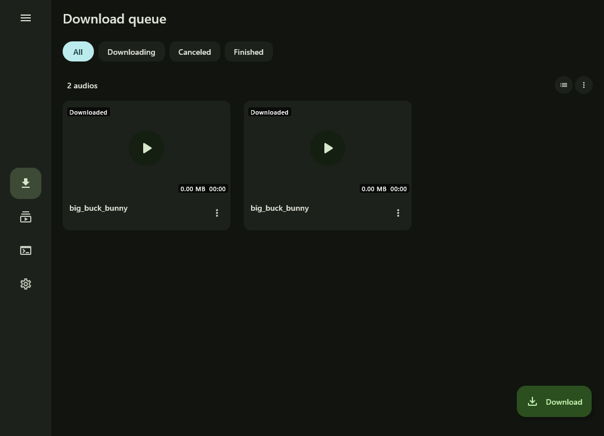

<picture>
  <source media="(prefers-color-scheme: dark)" srcset="docs/logo-dark.png">
  
</picture>

# Aeras

A video and audio downloader for Windows, built on [yt-dlp](https://github.com/yt-dlp/yt-dlp).

Aeras is a Windows port of [Seal](https://github.com/JunkFood02/Seal), an Android downloader by
JunkFood02. The interface and the download logic are Seal's Kotlin and Jetpack Compose code,
running on Compose Multiplatform. The Android-specific parts were replaced with a desktop layer
written for this project. Aeras is an independent project and is not affiliated with or endorsed by
the Seal author.

## Features

- Download video or audio from the sites yt-dlp supports
- Pick formats, subtitles and clips per download, or use presets
- Playlists, with per-item selection
- Download queue with cancel and resume, and a download history
- Custom yt-dlp command templates
- Cookies imported from a browser-exported `cookies.txt`, for sites that need a login
- Material 3 interface with light and dark themes and translations

## Install

Download the installer from the [Releases](https://github.com/Pratyuttar/Aeras/releases) page and
run it. It asks for administrator rights and lets you choose the install folder. The installer is
not code-signed, so Windows may show a SmartScreen prompt.

On first start Aeras uses yt-dlp and FFmpeg if they are already installed and on the `PATH`.
Otherwise it offers to download both into its own data folder.

Settings and history are stored in `%APPDATA%\Aeras`. Downloads go to `Downloads\Aeras` unless you
choose another folder.

## Build from source

Requires Windows and a JDK, version 17 to 24.

    gradlew.bat run                     run from source
    gradlew.bat createDistributable     portable app in build\compose\binaries\main\app\Aeras
    gradlew.bat packageMsi              installer in build\compose\binaries\main\msi
    gradlew.bat selfTest                end-to-end check: test download, audio extraction, window picture

## How the port works

Seal is an Android app. Most of its code is Compose UI, which also runs on the desktop, so the port
keeps that code and replaces what it depends on underneath.

| Android piece | Desktop replacement |
|---|---|
| youtubedl-android (yt-dlp inside a bundled Python runtime) | a process runner around the standalone `yt-dlp` program: output parsing for progress, cancellation, self-update |
| bundled FFmpeg and aria2c | FFmpeg found on the `PATH`, shipped with the app, or downloaded on first start |
| MMKV preferences | a small JSON-backed key-value store |
| Room database | the same DAO interface implemented in memory and saved as JSON |
| Android resources (`strings.xml`, plurals, drawables) | a loader that reads the original resource files, including all translations |
| `Context`, `Intent`, `Toast`, permissions, activity results | minimal stand-ins: open and reveal files, clipboard, native file dialogs, in-window toasts |
| WebView login for cookies | import of a Netscape-format `cookies.txt` |
| Foreground service and notifications | not needed for a desktop window; tray notifications when the window is in the background |

The port's own code is in `src/main/kotlin/io/github/pratyuttar/aeras` (app identity, storage,
tools, self-test) and `src/main/kotlin/compat` (stand-ins for the Android and third-party APIs).
The code under `src/main/kotlin/com/junkfood/seal` is Seal's, with the changes needed for desktop.

## Differences from Seal on Android

- No share-sheet quick download, wallpaper-based colours, SD card or mobile-data settings
- No in-app app updates; yt-dlp itself can still be updated from the settings
- Sharing a link copies it to the clipboard; sharing a file shows it in Explorer
- The original app's sponsor page and community links are not included

## Licence and credits

Aeras is free software under the [GNU General Public License v3.0](LICENSE), the licence of the
project it is built from.

- Based on [Seal](https://github.com/JunkFood02/Seal), copyright JunkFood02 and contributors,
  GPL-3.0. Modified for Windows in November 2026. See [NOTICE.md](NOTICE.md).
- Downloads are done by [yt-dlp](https://github.com/yt-dlp/yt-dlp); media processing by
  [FFmpeg](https://ffmpeg.org/).
- Other libraries are listed on the Credits page inside the app.

Use it only to download content you have the right to download.
